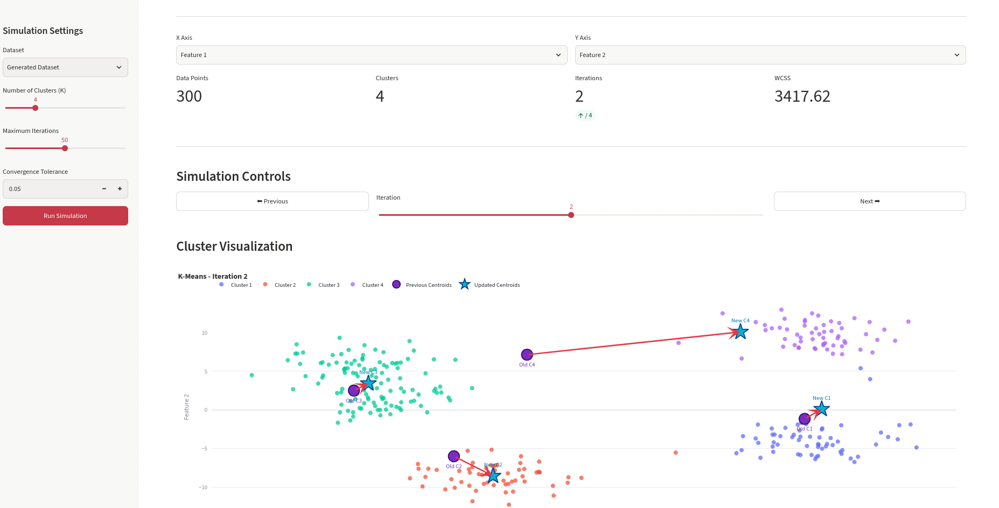
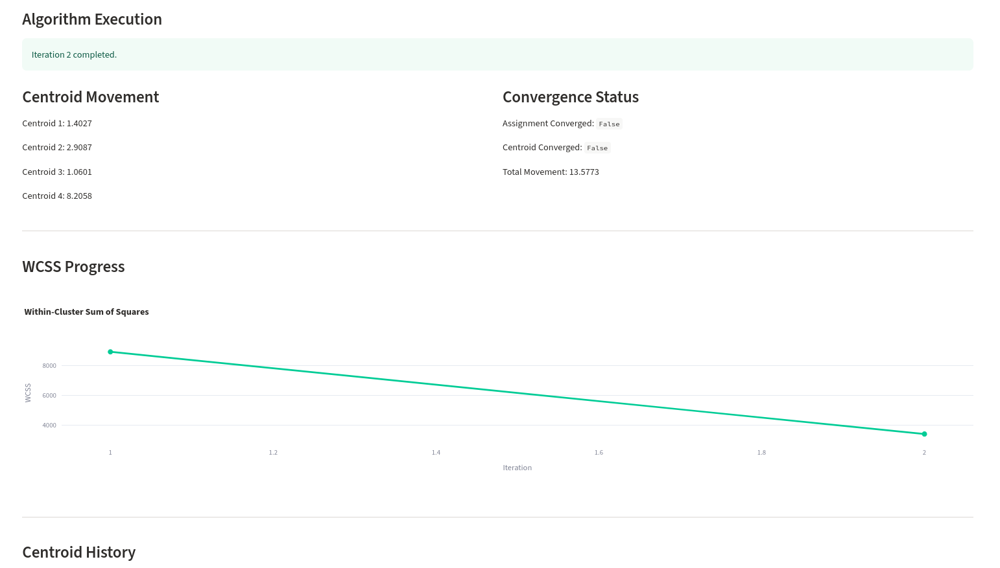

# K-Means Clustering Simulator

An interactive Streamlit app for exploring how K-Means clustering assigns data points to clusters and updates centroids. Step through each iteration, inspect centroid movement, and track within-cluster sum of squares (WCSS).

## Contents

- [Project overview](#project-overview)
- [K-Means in brief](#k-means-in-brief)
- [Simulation features](#simulation-features)
- [Datasets](#datasets)
- [Supported Formats](#supported-formats)
- [Installation and setup](#installation-and-setup)
- [Run the app](#run-the-app)
- [Project structure](#project-structure)
- [Implementation notes](#implementation-notes)
- [Dataset attribution and licensing](#dataset-attribution-and-licensing)
- [Screenshots](#screenshots)

## Project overview

The project implements K-Means in NumPy and visualizes its execution with Streamlit and Plotly. It is designed as an educational demonstration rather than a general-purpose machine-learning package.

## K-Means in brief

K-Means is an unsupervised learning algorithm that groups data points into **K clusters**. Each cluster is represented by a centroid: the mean position of the points assigned to that cluster.

1. Choose an initial position for each centroid.
2. Assign every point to its nearest centroid using Euclidean distance.
3. Move each centroid to the mean of the points assigned to it.
4. Repeat the assignment and update steps until the algorithm converges or reaches its iteration limit.

The algorithm calculates **within-cluster sum of squares (WCSS)**, the sum of squared distances between points and their assigned centroids. Different initial centroids can lead to different results; K-Means does not guarantee the globally optimal clustering.

## Simulation features

| Feature | What it does |
| --- | --- |
| Dataset selection | Choose the bundled customer workbook, the generated example, or a [supported file](#supported-formats) placed in `data/`. |
| Feature selection | Choose two numeric columns to use as the X and Y features. |
| Clustering controls | Set K, the maximum iteration count, and the convergence tolerance. |
| Iteration navigation | Inspect the initial state and move through completed iterations with the slider or Previous/Next buttons. |
| Cluster visualization | View point assignments, previous and updated centroids, and arrows showing centroid movement. |
| Progress details | Follow WCSS, per-centroid movement, convergence status, and centroid history. |
| Final results | View final WCSS, centroids, iteration count, and cluster distribution. |

## Supported formats
The simulation supports the following file formats:

- `.csv` – Comma-separated values
- `.xlsx` – Excel workbook
- `.xls` – Excel legacy workbook

Place your dataset in the `data/` directory to be able to select it in the application.

### Available controls

- **K:** from 2 to at most 10, limited by the number of valid and distinct data points. The default is 5, or the largest available value if fewer than 5 clusters are possible.
- **Maximum iterations:** 1–100; default 50.
- **Convergence tolerance:** 0.0001–10; default 0.05.

The simulation stops when assignments are unchanged between iterations, when the **sum of centroid movements** is below the tolerance, or when the maximum iteration count is reached.

## Datasets

### Bundled customer dataset

The repository includes [`data/Mall Customers.xlsx`](data/Mall%20Customers.xlsx), an Excel workbook with one worksheet (`Sheet1`), 200 rows, and 7 columns. Numeric columns include `Age`, `Annual Income (k$)`, and `Spending Score (1-100)`.

The app also creates a synthetic **Generated Dataset** with 300 two-dimensional samples, five centers, and a cluster standard deviation of 1.5.


### Add another dataset

Place a CSV (`.csv`) or Excel (`.xlsx` or `.xls`) file directly inside `data/`. The app discovers supported files in that folder and makes them available in the dataset selector. Only numeric columns can be selected. Rows with non-finite values in either selected feature are excluded.

For meaningful results, choose measured features rather than numeric identifiers such as customer IDs. The current checkout contains the customer workbook as its only dataset file; the app's generated example is available separately.

## Installation and setup

You need Python 3. Project dependencies are pinned in [`requirements.txt`](requirements.txt).

From the project root, create and activate a virtual environment:

```bash
python -m venv .venv
```

```bash
# macOS / Linux
source .venv/bin/activate

# Windows PowerShell
.venv\Scripts\Activate.ps1
```

Install the dependencies:

```bash
python -m pip install -r requirements.txt
```

## Run the app

From the project root, start Streamlit:

```bash
streamlit run app.py
```

After running the command, Streamlit will display a local URL in your terminal (usually http://localhost:8501).

Copy this URL and paste it into your web browser (Chrome, Firefox, Edge, etc.) to open the application.

Note: Keep the terminal open while using the application. Closing it will stop the Streamlit server.

## Use the simulator

1. Select a dataset and set K, the maximum iteration count, and the convergence tolerance in the sidebar.
2. Choose the X and Y numeric features on the main page.
3. Click **Run Simulation** in the sidebar.
4. Use the iteration slider or Previous/Next buttons to inspect the recorded steps.


## Project structure

```text
.
├── app.py                  # Streamlit interface and visualizations
├── kmeans.py               # NumPy K-Means implementation
├── requirements.txt        # Pinned Python dependencies
├── README.md               # Project documentation
└── data/
    └── Mall Customers.xlsx # Bundled customer dataset
    ...add your your own datasets here
```

## Implementation notes

- The implementation clusters exactly two features at a time; it does not cluster all numeric columns simultaneously.
- Features are used in their original units. K-Means is sensitive to feature scale, so a feature with a larger numeric range can dominate the distance calculation. Consider scaling features before comparing differently scaled measurements.
- Initial centroids are randomly selected from the data points. The implementation does not use k-means++ or repeat runs to select the best WCSS result. The main idea is to demonstrate the algorithm's behavior rather than to optimize clustering quality.
- Empty clusters are reinitialized using a point farthest from the current centroids. Multiple empty clusters may select the same point, and WCSS is not guaranteed to decrease on every iteration.
- The convergence tolerance is applied to the sum of all centroid movements, not to each centroid separately.
- The app creates a new model for each run. When using `KMeans` directly, create a new instance for each fit; the class does not fully reset its convergence state when `fit()` is called again.
- WCSS is useful for comparing results on the same data and feature scaling, but it does not by itself determine the appropriate value of K.

## Dataset attribution and licensing

The customer workbook comes from the [Mall Customers dataset on Kaggle](https://www.kaggle.com/datasets/simtoor/mall-customers). Check the dataset's current license and usage terms before redistributing it, and include any required attribution.

No project license file is currently included. Add a license for the code before publishing if you want to specify how others may use it.

## Screenshots





